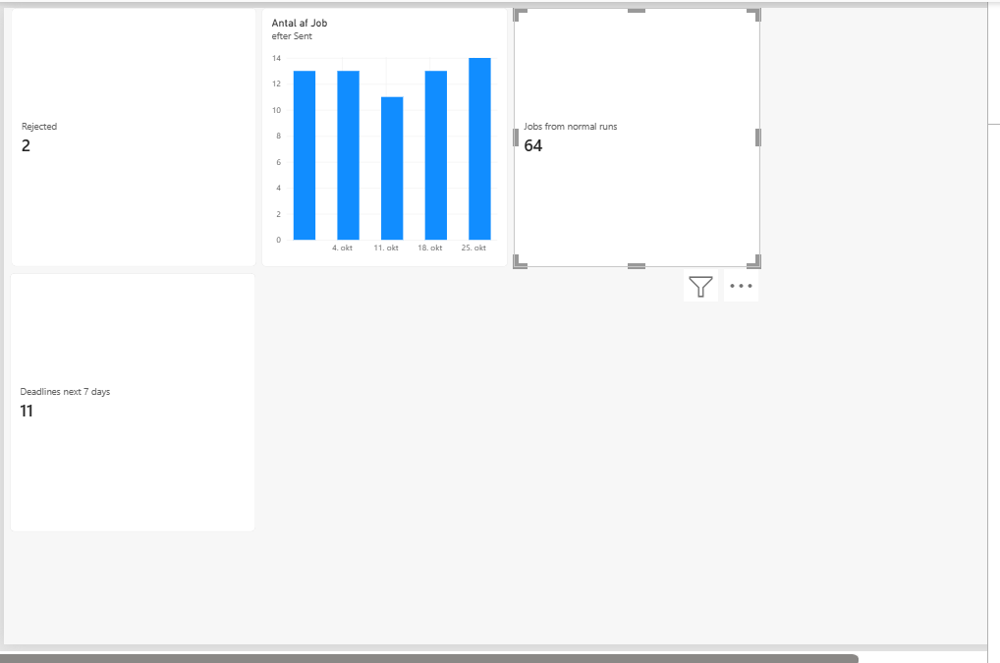

# Job search dashboard – Power BI built with AI help

A small Power BI report of my own job search (Sep–Oct 2026), built in Power BI Desktop with help from Claude. One of the measures was added by Claude Code through Microsoft's **Power BI Modeling MCP server**, and I checked its result myself.



## The question

My weekly job agent (an AI agent that searches job sites every Monday and emails me a list) writes every job it sends me to a log. I wanted to answer three things from that log:

1. How many jobs does a normal Monday run find?
2. How many applications have I sent, and how many were rejected?
3. How many open jobs have a deadline in the next 7 days?

## The data

`data/job_log_anonymised.csv`: 90 rows, one per job the agent sent me, 28 Sep – 26 Oct 2026.

The data is **real but anonymised**:

| Column | What it contains |
|---|---|
| Sent | the date the agent sent the job (unchanged) |
| Job | role category, e.g. `Data / BI analyst` (9 categories); markers like `(v4 test)` are kept |
| Employer | `Public employer 1`, `Private employer 1`, `Organisation employer 1` … (no names) |
| Link | `removed` |
| Deadline | unchanged: a date, `unknown` or `unknown (checked 2026-10-19)` |
| Status | e.g. `sent`, `expired`, `applied (2026-10-15, skill v2)`, `rejected (2026-10-16) – note removed` |

## Cleaning (Power Query)

The raw log is messy, so I added three columns:

| Column | Type | Formula (M) | Why |
|---|---|---|---|
| DeadlineDate | Date | `try Date.FromText([Deadline], [Format="yyyy-MM-dd"]) otherwise null` | `Deadline` mixes dates and text, so Power BI read it as text. Rows without a real deadline become blank, not a fake date. |
| StatusGroup | Text | `List.First(Text.Split(List.First(Text.Split([Status], " (")), " –"))` | Cuts the notes off the status → 5 groups: sent, expired, applied, rejected, not interested. |
| IsTest | True/False | `Text.Contains([Job], " test)")` | 26 rows came from test versions of the agent (16 on 12 Oct, 10 on 13 Oct). |

## Measures (DAX)

```
Applied = COUNTROWS(FILTER(job_log, job_log[StatusGroup] = "applied"))

Rejected = COUNTROWS(FILTER(job_log, job_log[StatusGroup] = "rejected"))

Deadlines next 7 days = COUNTROWS(FILTER(job_log,
    job_log[StatusGroup] = "sent"
    && job_log[DeadlineDate] >= TODAY()
    && job_log[DeadlineDate] <= TODAY() + 7))
```

**Jobs from normal runs** counts the rows where `IsTest` is false. Claude Code wrote this one through the MCP server; its exact DAX is in `job_search_public.SemanticModel/definition/tables/job_log.tmdl`.

## Findings

- A normal Monday run finds **11–14 jobs** (13, 13, 11, 13, 14). The chart filters out the test rows; with them, 12 Oct looked like 27 jobs and 13 Oct like an extra run.
- **64** of the 90 jobs came from normal runs. I checked this independently: 90 rows − 26 test rows = 64.
- **3** applications sent, **2** rejections.
- Test rows stay in Applied and Rejected, because they are real jobs I applied to; they only leave the per-run chart. I checked that no test row is a copy of another row.

## How AI was used

| Step | Who |
|---|---|
| Power Query formulas, Applied measure | Claude wrote them in chat; I ran and checked them |
| Rejected measure, the filter conditions in Deadlines next 7 days | I wrote them |
| Jobs from normal runs | Claude Code added it to the model through the Power BI Modeling MCP server |
| Checking every number | me, against the log and by hand |

### The MCP server

[Power BI Modeling MCP server](https://github.com/microsoft/powerbi-modeling-mcp) (Microsoft, preview, v1.0.0) lets an AI agent read and change a Power BI semantic model: tables, columns, measures, relationships. It does not touch report visuals.

What I learned setting it up with Claude Code:

1. **The first start failed.** The server downloads a ~40 MB Windows part on first start, which most likely took longer than Claude Code waits. Running the same `npx` command by hand showed its own log and cached the download; after that it connected with 22 tools.
2. **Read the server's own log.** It said `Mode: ReadWrite` and `Skip Confirmation: Enabled`: the server itself does not ask before changing the model. The README had led me to expect a confirmation.
3. **A change happened without a question.** Claude Code created the measure without asking me first. In the project's `.claude/settings.local.json` I found an `allow` rule for the whole server. I changed it to `ask`, and now Claude Code asks before every tool call.
4. **Least privilege:** the server is registered only for one project folder, unused connectors are switched off there, and I made a backup of the report before any change.
5. **Verify AI output:** Claude Code said itself that it had not evaluated the measure. I checked it against numbers I already knew (90 − 26 = 64).

All of it is free: Power BI Desktop, the MCP server, and Claude Code on a Claude Pro subscription. I did not use Copilot in Power BI or Microsoft Fabric, because both need paid capacity.

## Open it yourself

1. Install [Power BI Desktop](https://learn.microsoft.com/en-us/power-bi/fundamentals/desktop-get-the-desktop) (free, Windows).
2. Download this repository and open `job_search_public.pbip`.
3. The data source points to the folder on my PC. Go to **Transform data**, click the gear next to the **Source** step, and choose `data/job_log_anonymised.csv` from your copy. Then **Close & Apply**.

## Limitations

- 90 rows over five weeks: enough to learn on, too little for conclusions about the job market.
- The role categories were made with keyword rules, so a few titles may be in the wrong category.
- The data is a snapshot from 26 Oct 2026. **Deadlines next 7 days** uses `TODAY()`, so it changes every day and reaches 0 once all deadlines have passed.
- The MCP server is a preview; it may change or stop working.

© 2026 Holger Klint
